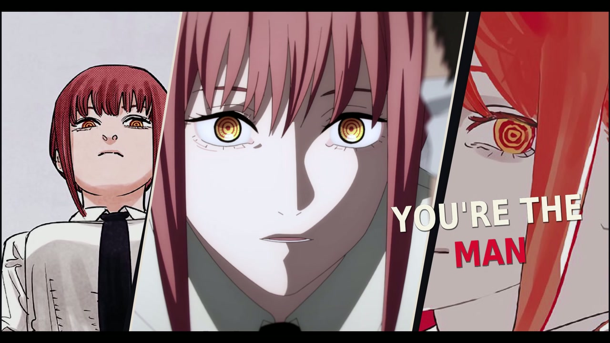
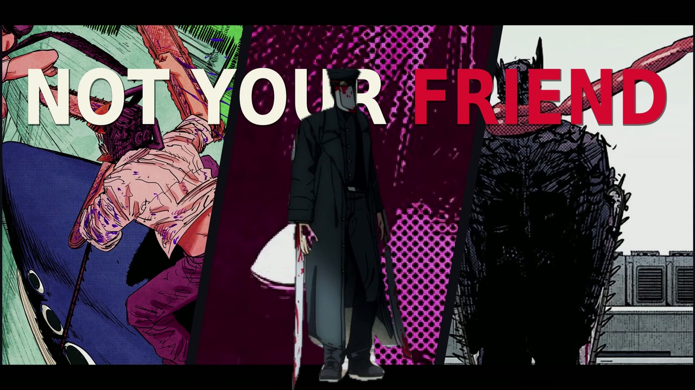
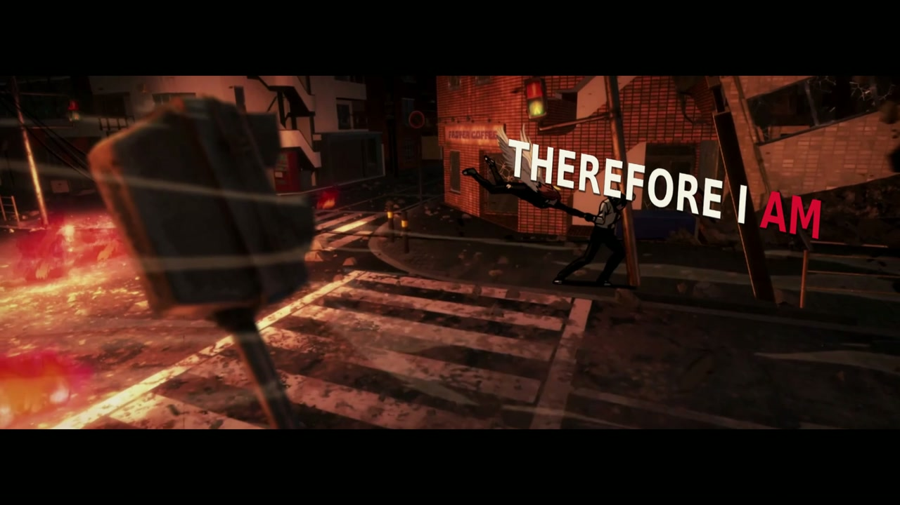
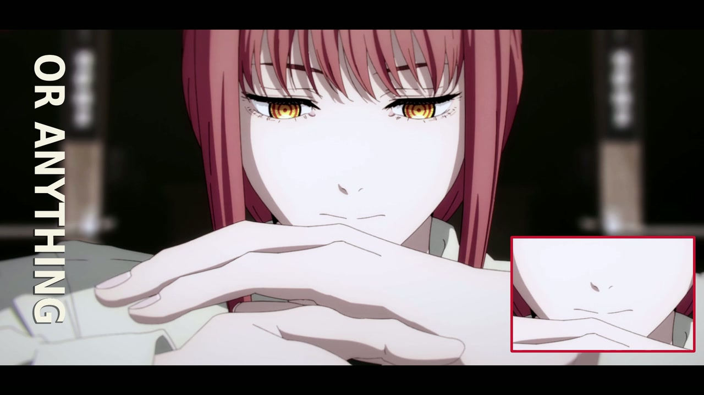
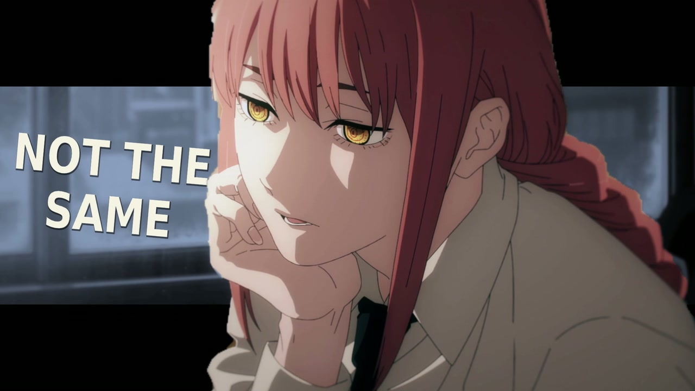
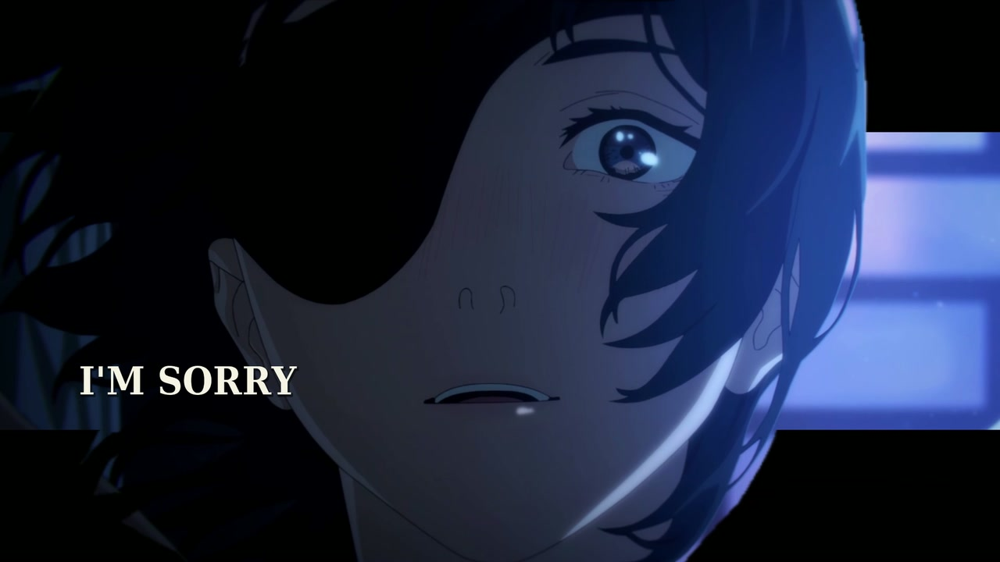
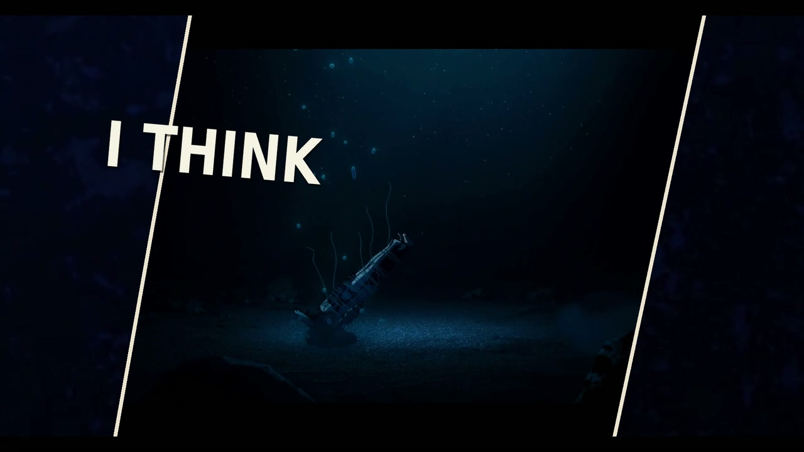
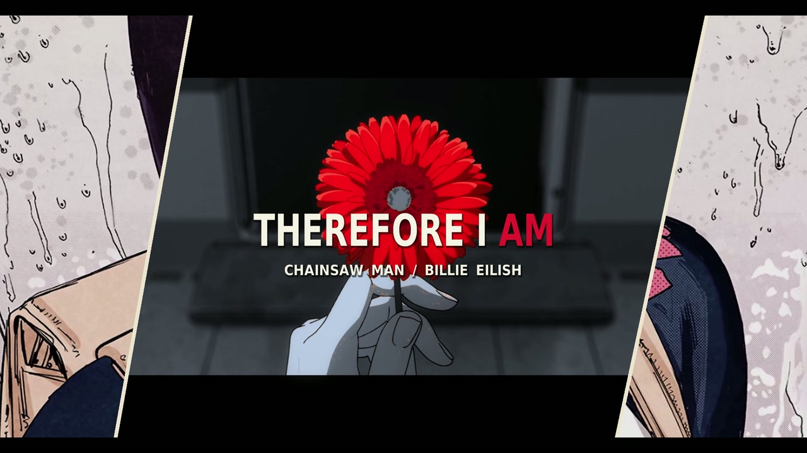

# Dark AMV Editing Skill

**暗黑动漫混剪：让叙事、动作、歌词和画面空间一起卡点。**

从《电锯人 × Therefore I Am》V1–V3 的制作过程及 ref3 风格分析中，整理出一套可交给 Codex 使用的剪辑 skill。覆盖素材筛选、故事结构、音乐分析、空间歌词、全彩漫画合成、人物轮廓、调色、几何效果、动态画幅与成片质检。**不包含 V4。**



*V3 实际成片 · 00:10.267：原彩漫画与动漫近景组成三联画，文字避开中央眼睛。*

[Skill 入口](dark-amv-editing/SKILL.md) · [音乐与空间歌词](dark-amv-editing/references/music-lyrics-story.md) · [视觉手法](dark-amv-editing/references/visual-editing.md) · [流程与质检](dark-amv-editing/references/pipeline-and-quality.md)

## 可以怎样用

- 参考一支 AMV，拆解它的叙事、颜色、文字、动作与转场分工，再用另一首音乐重建节奏。
- 在已有剪辑上增加动漫素材与原彩漫画，让文字随留白、视线、墙面、地面和人物遮挡变化。
- 给动作峰、字的落定、几何合拢与短滤镜分配重音，控制高潮与停顿。
- 保留旧版，在独立版本中迭代，并用时间线、缓存与实际成片证据检查交付。

这是**操作方法 + 轻量检查工具**。渲染可由剪辑软件或自建 FFmpeg/Python 工程完成；仓库没有打包原片、歌曲、整页漫画、完整歌词或完整成片，也不提供一键重渲染原项目的引擎。

## 效果图

下图均从 **V3 最终 MP4 直接提取**，仅缩放至 1280×720 并编码为 JPEG，没有为展示重新合成。单帧用于说明构图与层级，动态卡点仍需在视频中判断。[截图时间与事实说明](docs/gallery.json)

| 人物轮廓 × 后置歌词 × 漫画背景 | 场景透视 × 红白歌词 |
|---|---|
|  |  |
| **00:51.400** · 主体站到文字前面，漫画承担两侧信息。 | **01:54.500** · 文字方向与街道结构相呼应。 |

| 局部放大蒙版 × 竖排文字 | 人物前景 × 动态画幅 |
|---|---|
|  |  |
| **00:06.567** · 细节窗口补充手与嘴的关系，主画面保持完整。 | **00:32.467** · 背景被遮幅，前景人物保留独立层级。 |

| 冷蓝暗部 × 可读人物 | 斜向窗口 × 冷蓝空间 |
|---|---|
|  |  |
| **01:57.500** · 暗黑氛围保留眼睛与面部层次。 | **02:44.367** · 浅色斜边围出水下窗口，改变画面的组织方式。 |

## 方法的核心

| 要解决的问题 | 实际处理 |
|---|---|
| 画面多却缺乏故事 | 以关系和意象串联段落，局部保留准备、接触、反应；静段主动减信息。 |
| 卡点只是平均换镜 | 音乐段落、词界、动作峰、效果峰分别对齐；实测瞬态和工作拍格交叉使用。 |
| 歌词总在同一位置 | 每镜记录主体与负空间，跨切点重排；人物前后遮挡、地面透视、大小词交替。 |
| 黑暗调色导致看不清 | 先校正曝光，保留肤色与黑衣细节，再压环境饱和、强调红色，短时使用极端色彩。 |
| 漫画只是贴纸 | 裁出有主体的原彩画格，通过三联、斜分屏、背景翼或局部窗口参与构图。 |
| 蒙版跟不上变速 | 原画与轮廓共享源帧、时间映射、裁切和相机变换，替换来源后重新配准。 |
| 特效多却没有重音 | 把合拢、落定、闪帧峰值放到重音上；多数切点保留硬切，段落间有强弱差。 |
| 参数正确但成片不对 | 检查实际渲染后的文字与边缘，验证缓存依赖、完整解码和音乐同步。 |


## 安装到 Codex

克隆本仓库后，将 `dark-amv-editing` 整个目录放入自己的 skills 目录：

```bash
git clone https://github.com/GreyNails/dark-amv-editing-skill.git
cd dark-amv-editing-skill
mkdir -p "${CODEX_HOME:-$HOME/.codex}/skills"
cp -R dark-amv-editing "${CODEX_HOME:-$HOME/.codex}/skills/"
```

在能发现新 skill 的 Codex 会话中调用：

```text
使用 $dark-amv-editing。
参考我提供的分析，使用指定音乐、动漫和全彩漫画素材制作暗黑系混剪。
先整理故事和音乐段落，歌词跟随画面构图，动作与效果峰值卡重音。
保留原版，所有新产物放入独立版本目录，并交付成片、预览、参数与质检。
```

也可直接让 agent 读取本地 `dark-amv-editing/SKILL.md`。skill 不固定作品、歌曲、镜头数量或软件；案例参数应根据新素材重新测量。

## 工具与示例

Python 3 即可运行时间线审查；抽帧另外需要 FFmpeg / ffprobe。

```bash
# 检查不依赖媒体的三镜头示例
python3 dark-amv-editing/scripts/audit_timeline.py \
  dark-amv-editing/assets/timeline.example.json

# 从自己的成片抽帧，生成本地 HTML 图库
python3 dark-amv-editing/scripts/review_frames.py work/final.mp4 \
  --timeline work/timeline.json --include-lyrics --out work/review

# 验证工具行为
python3 -m unittest discover -s tests -v
```

审查器检查连续帧、源区间、变速映射、局部/绝对鼓点帧和文字区间，源复用默认提示，可设为严格错误。它不渲染特效，也不自动判定构图优劣。抽帧工具生成实际成片的首/中/末与歌词关键时刻，并保护已有审片目录。[字段、命令与限制](dark-amv-editing/references/timeline-and-tools.md)

## V1–V3 提炼依据

| 版本 | 主要进展 |
|---|---|
| V1 | 135 镜头；建立身份、控制、反抗、靠近、背叛、退潮与再释放的情绪骨架；41 组精选歌词。 |
| V2 | 解压并校验单集来源，逐镜替换旧总集篇；扩展至 145 镜头，28 幅原彩漫画用于 30 处构图；加强人物与画框层级。 |
| V3 | 覆盖 12 集与剧场版；89 组歌词拆为 101 个显示词组、171 个构图区间；加深逐镜布局和实测重音配合。 |

V3 统计：**145 镜头 / 9 组动态人物轮廓 / 37 处几何构图 / 47 处色彩蒙版 / 18 处动态遮幅 / 92 个切点映射实测瞬态 / 28 个动作峰另行对齐**。这些类别可重叠，不代表不同镜头数相加；也不是其它作品的最低要求。

V3 实际交付为 1920×1080、30fps、5207 帧、约 2分54秒。方法和数字核对自该版本的最终时间线、设计统计、制作说明与质检记录。参考分析只支持可见效果与组织方式，不能证明原作者使用过某个 LUT、插件或确切参数。

## 仓库结构

```text
dark-amv-editing/
├── SKILL.md                       # agent 的工作入口
├── agents/openai.yaml             # skill 展示信息
├── references/                    # 音乐/视觉/制作/字段与工具
├── scripts/                       # 时间线审查、成片抽帧
└── assets/timeline.example.json   # 原创占位文字的最小例子
docs/
├── images/                        # 8 张 V3 实帧效果图
└── gallery.json                   # 时间、帧号、图片说明
tests/                             # 工具行为测试
```



*V3 实际成片 · 02:49.667：用花朵与静止构图收束强度，让尾声有停留。*

代码与原创文档使用 [MIT 许可](LICENSE)；展示图中的原作品内容不在该许可内，见 [内容范围说明](NOTICE.md)。
